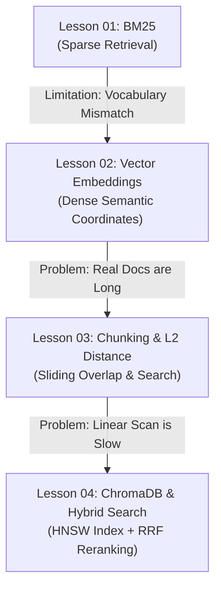

# RAG Mastery: Interactive Student Guide & Concept Assessment

> **Welcome to the RAG (Retrieval-Augmented Generation) Learning Curriculum!**  
> This guide accompanies the 4 progressive notebooks in [`src/notebooks/`](file:///home/kit/Documents/Sep2026/TDS/temp/src/notebooks).  
> If you run each notebook cell-by-cell and observe the outputs, you will be able to answer every question below and master modern retrieval architectures from first principles.

---

## Curriculum Overview & Learning Map

---

## Notebook 01: BM25 Keyword Search

**Notebook Location:** [`src/notebooks/01-bm25.ipynb`](file:///home/kit/Documents/Sep2026/TDS/temp/src/notebooks/01-bm25.ipynb)  
**Core Concepts:** Term Frequency ($\text{TF}$), Inverse Document Frequency ($\text{IDF}$), Length Penalty ($b$), Term Saturation ($k_1$), Exact Identifiers vs. Vocabulary Mismatch.

### How to Run:
1. Open [`01-bm25.ipynb`](file:///home/kit/Documents/Sep2026/TDS/temp/src/notebooks/01-bm25.ipynb) in your IDE.
2. Run cells sequentially from Step 1 to Step 5.
3. Observe how each document receives a numerical BM25 score.

### Questions:

#### Question 1 (NAT — Numerical Answer Type)
**In Cell 1, when `data.txt` is loaded and sliced into paragraphs, how many total document paragraphs are loaded into memory?**  
*Instruction:* Look at the printed output of Cell 1: `Loaded X document paragraphs.`  
*Answer Format:* Single integer (e.g., `25`).

---

#### Question 2 (NAT — Numerical Answer Type)
**In Cell 3, when scoring the corpus for the query `"Titan-X9 SKU-9921"`, which Document Number (`Doc #`) achieves Rank 1, and what is its BM25 score (rounded to 2 decimal places)?**  
*Instruction:* Check the printed leaderboard table in Cell 3 under Rank 1.  
*Answer Format:* `Doc #X, Score: Y.YY`

---

#### Question 3 (MCQ — Multiple Choice Question)
**In the BM25 formula, what is the role of parameter $k_1 \approx 1.5$ (Term Saturation)?**  
- **A)** It removes common English stop words like "the" and "is".
- **B)** It caps the bonus of word repetitions so that keyword stuffing does not inflate scores infinitely.
- **C)** It calculates the straight-line geometric distance between vectors.
- **D)** It forces long documents to always receive higher scores than short documents.

---

#### Question 4 (MCQ — Multiple Choice Question)
**When searching for `"What technology allows devices to run without power grid connectivity?"` in Cell 5, why does Doc #11 (which describes GreenVolt) fail to achieve Rank 1?**  
- **A)** GreenVolt is not an edge hardware device.
- **B)** Doc #11 is over 100 words long and was penalized to zero.
- **C)** BM25 matches exact letter spelling; Doc #11 uses the terms *"energy-harvesting"* and *"off-grid"* rather than *"power grid"*.
- **D)** The BM25 algorithm ignores documents published in October 2023.

---

#### Question 5 (NAT — Numerical Answer Type)
**In Cell 5, what rank did Doc #11 (GreenVolt) actually achieve out of the 30 documents when searching for `"What technology allows devices to run without power grid connectivity?"`?**  
*Instruction:* Check the print statement in Cell 5: `Notice: Doc #11 (GreenVolt) ranked #X out of 30!`.  
*Answer Format:* Single integer (e.g., `4`).

---

## Notebook 02: Vector Embeddings & 3D Visualization

**Notebook Location:** [`src/notebooks/02-embeddings-visualization.ipynb`](file:///home/kit/Documents/Sep2026/TDS/temp/src/notebooks/02-embeddings-visualization.ipynb)  
**Core Concepts:** Dense Vectors as Semantic Coordinates, Cosine Similarity, PCA Dimensionality Reduction (768D $\to$ 3D), Cluster Visualization.

### How to Run:
1. Make sure your `.env` file contains your Gemini API key (`GEMINI_API_KEY=...`).
2. Run cells 1 through 7 in [`02-embeddings-visualization.ipynb`](file:///home/kit/Documents/Sep2026/TDS/temp/src/notebooks/02-embeddings-visualization.ipynb).
3. Interact with the 3D Plotly visualization (rotate, zoom, hover over points).

### Questions:

#### Question 6 (NAT — Numerical Answer Type)
**How many total sentences were defined across the 4 topics in Cell 2, and what is the exact dimensionality (number of coordinates) of each vector produced by `gemini-embedding-001` in Cell 3?**  
*Instruction:* Inspect the outputs printed in Cell 2 and Cell 3.  
*Answer Format:* `X sentences, Y dimensions`

---

#### Question 7 (NAT — Numerical Answer Type)
**In Cell 5, what is the calculated Cosine Similarity between `"playful golden retriever puppy"` and `"friendly loyal domestic dog"` (rounded to 2 decimal places)?**  
*Instruction:* Inspect the output printed under `Same Topic : 'puppy' vs 'dog' -> X.XXXX`.  
*Answer Format:* Decimal (e.g., `0.75`).

---

#### Question 8 (MCQ — Multiple Choice Question)
**Why is the cosine similarity between `"puppy"` and `"dog"` (~0.65) significantly higher than the similarity between `"puppy"` and `"neural network"` (~0.48)?**  
- **A)** "puppy" and "dog" share more identical letters.
- **B)** The embedding model projects texts sharing similar real-world concepts into vectors that point in nearly the same geometric direction.
- **C)** The PCA algorithm altered their coordinates to force them together.
- **D)** BM25 gave them identical inverse document frequencies.

---

#### Question 9 (MCQ — Multiple Choice Question)
**Why do we apply PCA (Principal Component Analysis) to reduce the vectors from 768 dimensions down to 3 dimensions before plotting in Plotly?**  
- **A)** Because human visual perception is limited to 3 spatial dimensions ($X, Y, Z$).
- **B)** Because Gemini vectors are inaccurate in 768 dimensions.
- **C)** Because Plotly can only accept positive numbers.
- **D)** To remove all numbers below zero.

---

#### Question 10 (NAT — Numerical Answer Type)
**In Cell 6, what is the exact NumPy shape of `embeddings_3d` after fitting PCA with `n_components=3`?**  
*Instruction:* Look at the output of Cell 6: `Reduced from 768 dimensions down to X dimensions (X, Y, Z)`.  
*Answer Format:* `(samples, dimensions)`, e.g., `(10, 3)`.

---

## Notebook 03: Chunking, Overlap & Vector Search (L2 Distance)

**Notebook Location:** [`src/notebooks/03-chunking-l2-search.ipynb`](file:///home/kit/Documents/Sep2026/TDS/temp/src/notebooks/03-chunking-l2-search.ipynb)  
**Core Concepts:** Word-Level Chunking, Sliding Overlap Window, Seam Preservation, Euclidean (L2) Distance.

### How to Run:
1. Open [`03-chunking-l2-search.ipynb`](file:///home/kit/Documents/Sep2026/TDS/temp/src/notebooks/03-chunking-l2-search.ipynb).
2. Run cells 1 through 6.
3. Compare the tail of Chunk #1 and head of Chunk #2 to see the overlap.

### Questions:

#### Question 11 (NAT — Numerical Answer Type)
**In Cell 2, using `chunk_size = 40` words and `overlap = 10` words, how many total overlapping chunks are generated from the 781-word document?**  
*Instruction:* Check the print statement in Cell 2: `Total document words: 781 -> Created X overlapping chunks.`  
*Answer Format:* Single integer (e.g., `20`).

---

#### Question 12 (NAT — Numerical Answer Type)
**By how many words does the sliding chunk window advance forward on each step when `chunk_size = 40` and `overlap = 10`?**  
*Instruction:* Look at the step formula in `chunk_text`: `step = chunk_size - overlap`.  
*Answer Format:* Single integer.

---

#### Question 13 (MCQ — Multiple Choice Question)
**What is the primary reason for including an `overlap` between adjacent text chunks in RAG?**  
- **A)** To make the vector database store duplicate data so search becomes faster.
- **B)** To ensure that critical facts and sentences split across chunk boundaries are not broken in half and lost.
- **C)** To double the number of dimensions in the vector space.
- **D)** To convert dense vectors into sparse matrices.

---

#### Question 14 (MCQ — Multiple Choice Question)
**When using Euclidean (L2) Distance to measure similarity between a query vector and chunk vectors, which chunk is the best semantic match?**  
- **A)** The chunk with the largest distance value.
- **B)** The chunk with distance closest to $1.0$.
- **C)** The chunk with the smallest (lowest) distance value ($d=0.0$ being identical).
- **D)** The chunk with a negative distance value.

---

#### Question 15 (NAT — Numerical Answer Type)
**In Cell 6, when querying `"What is the catalog part number for the Titan-X9 processor and how much revenue did it generate in its first month?"`, which Chunk # achieves Rank 1, and what is its L2 distance (rounded to 4 decimal places)?**  
*Instruction:* Check the output of Cell 6 under Rank 1 for Question 1.  
*Answer Format:* `Chunk #X, Distance: Y.YYYY`

---

## Notebook 04: ChromaDB & Hybrid Search (Dense + BM25 + RRF + LLM Generation & Judge)

**Notebook Location:** [`src/notebooks/04-chromadb-hybrid-retrieval.ipynb`](file:///home/kit/Documents/Sep2026/TDS/temp/src/notebooks/04-chromadb-hybrid-retrieval.ipynb)  
**Core Concepts:** In-Memory Vector Store (ChromaDB), HNSW Graph Indexing, Sub-Linear Time Complexity ($\mathcal{O}(\log N)$), Reciprocal Rank Fusion (RRF), Prompt Augmentation, Grounded LLM Generation (`gemini-3.8-flash`), and Automated Evaluation via LLM-as-a-Judge against [`answer.txt`](file:///home/kit/Documents/Sep2026/TDS/temp/answer.txt).

### How to Run:
1. Open [`04-chromadb-hybrid-retrieval.ipynb`](file:///home/kit/Documents/Sep2026/TDS/temp/src/notebooks/04-chromadb-hybrid-retrieval.ipynb).
2. Run cells 1 through 13.
3. Observe:
   - Ingestion of 30 chunks into ChromaDB.
   - The 3-Way Showdown (Dense vs BM25 vs Hybrid).
   - **Step 8:** Grounded answer generation using `gemini-3.8-flash` with augmented retrieval context.
   - **Step 9:** Automated grading of the generated answer by an LLM Judge against the reference ground truth in `answer.txt`.

### Questions:

#### Question 16 (NAT — Numerical Answer Type)
**In Cell 3, how many total chunks are ingested and indexed into the ChromaDB collection `aura_knowledge`?**  
*Instruction:* Look at the output of Cell 3: `Successfully ingested X chunks...`.  
*Answer Format:* Single integer.

---

#### Question 17 (MCQ — Multiple Choice Question)
**Why is ChromaDB's HNSW graph index search significantly faster on 1 million documents than the linear scan used in Lesson 03?**  
- **A)** HNSW traverses a multi-layer hierarchical graph in $\mathcal{O}(\log N)$ time, bypassing 99%+ of vectors, whereas a linear scan computes distances against all $N$ vectors in $\mathcal{O}(N)$ time.
- **B)** ChromaDB deletes 90% of your documents during ingestion to save memory.
- **C)** HNSW converts all vectors to 1-bit integers.
- **D)** ChromaDB sends queries to external search engines.

---

#### Question 18 (NAT — Numerical Answer Type)
**Under the standard Reciprocal Rank Fusion (RRF) formula with smoothing parameter $k = 60$, if a document is ranked #1 by Dense Search and also ranked #1 by BM25 Search, what is its exact combined RRF score (rounded to 5 decimal places)?**  
*Instruction:* Calculate: $\text{RRF Score} = \frac{1}{60 + 1} + \frac{1}{60 + 1} = \frac{1}{61} + \frac{1}{61}$.  
*Answer Format:* Decimal (e.g., `0.03279`).

---

#### Question 19 (MCQ — Multiple Choice Question)
**In Step 8 (Augmented Generation), why do we inject the top-retrieved context chunks into the LLM prompt before calling `generate_content` instead of just asking the LLM the question directly?**  
- **A)** To force the LLM to output binary numbers.
- **B)** Because LLMs hallucinate or lack private/recent company knowledge; grounding the prompt in retrieved facts ensures the generated answer is strictly factual and verifiable.
- **C)** To bypass the ChromaDB HNSW vector index.
- **D)** To decrease the GPU memory allocated to the embedding model.

---

#### Question 20 (MCQ — Multiple Choice Question)
**In Step 9 (LLM-as-a-Judge), how does the evaluation judge determine whether the RAG system's generated response is correct?**  
- **A)** It compares character counts between prompt and response.
- **B)** It evaluates semantic and factual agreement between the generated answer and the trusted reference ground truth in `answer.txt`, issuing a `VERDICT: CORRECT` or `VERDICT: INCORRECT` with an explanation.
- **C)** It checks if the response contains more than 10 words.
- **D)** It re-runs BM25 on the query.

---

## Answer Key & Explanations

<strong>Click to expand Answer Key & Detailed Explanations</strong>

### Notebook 01 Answers:
1. **30** — `data.txt` contains exactly 30 distinct paragraphs separated by double newlines (`\n\n`).
2. **Doc #23, Score: 4.68** — Document 23 explicitly announces commercial availability of SKU-9921, earning the highest score.
3. **B** — In BM25, $(k_1 + 1) \cdot \text{TF} / (\text{TF} + k_1 \cdot \dots)$ provides saturation: as $\text{TF} \to \infty$, the term score asymptotes rather than growing linearly.
4. **C** — BM25 relies on exact lexical token matching. When queries use synonyms not present in the document text, the match score drops significantly.
5. **2** — Doc #11 achieved Rank 2 with a score of 3.33, losing to Doc #6 (score: 3.92) because of incidental common word matches.

### Notebook 02 Answers:
6. **10 sentences, 768 dimensions** — 10 sentences across 4 categories; `gemini-embedding-001` with `output_dimensionality: 768` outputs 768 floating-point coordinates per text.
7. **0.65** (or 0.6495) — Cosine similarity between the two pet sentences is high because they share semantic context.
8. **B** — Deep neural embedding models map semantic concepts to proximity in vector space.
9. **A** — Humans can only visualize up to 3 spatial dimensions; PCA finds the top 3 orthogonal axes of maximum variance.
10. **(10, 3)** — 10 input samples projected onto 3 principal components ($X, Y, Z$).

### Notebook 03 Answers:
11. **27** — 781 words chunked with window 40 and step 30 yields $\lceil(781 - 40) / 30\rceil + 1 = 27$ chunks.
12. **30** — Step size equals `chunk_size - overlap` = $40 - 10 = 30$ words.
13. **B** — Overlap creates an overlap buffer so sentences spanning the seam appear intact in at least one chunk.
14. **C** — Euclidean distance measures geometric separation; distance $0.0$ indicates identity, so smaller distances represent closer matches.
15. **Chunk #20, Distance: 0.6036** — Chunk #20 contains the text on SKU-9921 release and achieved the lowest Euclidean distance.

### Notebook 04 Answers:
16. **30** — All 30 paragraphs from `data.txt` were converted to 768D vectors and indexed in ChromaDB.
17. **A** — HNSW (Hierarchical Navigable Small World) structures vectors in layered graphs, reducing search complexity from $\mathcal{O}(N)$ to $\mathcal{O}(\log N)$.
18. **0.03279** — $\frac{1}{60 + 1} + \frac{1}{60 + 1} = \frac{2}{61} \approx 0.0327868 \approx 0.03279$.
19. **B** — Standard LLMs lack private internal knowledge and can produce hallucinations; injecting retrieved context grounds the answer in factual source material.
20. **B** — LLM-as-a-Judge compares the candidate answer against the trusted reference ground truth in `answer.txt` to grade factual correctness automatically with verifiable explanations.

